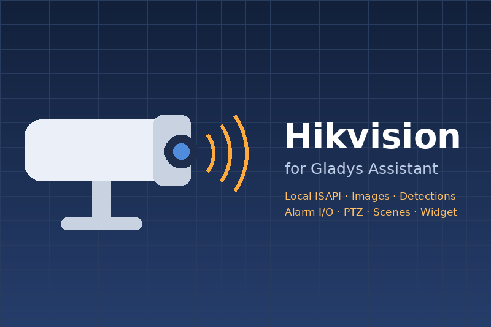

# Hikvision — Gladys Assistant integration

External integration for [Gladys Assistant](https://gladysassistant.com) (5.3+) that connects
**Hikvision IP cameras and recorders (NVR / DVR)** over their **local ISAPI**: camera images,
real-time detections, alarm inputs and outputs, PTZ, scene triggers and actions, and a dashboard
widget.



| Transport | Supported                                                                                 |
| --------- | ----------------------------------------------------------------------------------------- |
| **Local** | ✅ ISAPI over HTTP / HTTPS, Digest authentication, event stream (`transports: ["local"]`) |
| **Cloud** | ❌ No Hik-Connect: nothing leaves your network                                            |

User documentation: [English](docs/en.md) · [Français](docs/fr.md) · [Deutsch](docs/de.md) ·
[Español](docs/es.md).

## Features

| Surface              | What it does                                                                                                                                                                                                                                    |
| -------------------- | ----------------------------------------------------------------------------------------------------------------------------------------------------------------------------------------------------------------------------------------------- |
| Devices              | One device per camera channel (image, enabled-in-Gladys privacy gate, motion, line crossing, intrusion, tampering, detection switches, PTZ move, PTZ presets) and one "alarm I/O" device per device with dry contacts (inputs, output switches) |
| Camera images        | Periodic snapshots (`publishCameraImage`) + fresh capture on demand (`onGetImage`), always under 150 KB                                                                                                                                         |
| Real-time detections | The device's alert stream (`/ISAPI/Event/notification/alertStream`), one transition per detection                                                                                                                                               |
| Scene triggers       | `event_detected` (filters: camera, event, target person / vehicle), `camera_offline`, `camera_online`                                                                                                                                           |
| Scene actions        | `take_snapshot`, `set_detection` (arm / disarm), `goto_preset`                                                                                                                                                                                  |
| Widget               | `hikvision`: cameras online, detections (24 h), live image, last detection per camera, Snapshot / Disarm / Arm                                                                                                                                  |
| Configuration action | `test_connection`: one line per device, with what to fix                                                                                                                                                                                        |
| Transport badge      | `local` / `unreachable` per device, degraded (orange dot) when the event stream is down                                                                                                                                                         |
| Languages            | English, French, German, Spanish (configuration, messages, widget, documentation)                                                                                                                                                               |

## Project structure

```
index.js                         SDK wiring only (handlers registered before connect)
src/hub.js                       stations <-> Gladys: devices, states, images, events, badges, status
src/hikvision/client.js          HTTP client (node:http/https), Digest auth, typed errors
src/hikvision/digest.js          RFC 7616 Digest (MD5, SHA-256, -sess), Basic fallback
src/hikvision/isapi.js           one function per ISAPI question (info, channels, I/O, PTZ, detections, snapshot)
src/hikvision/alertStream.js     the long-lived event stream, watchdog and reconnection
src/hikvision/events.js          alert parsing, event keys, one transition per detection
src/hikvision/station.js         one device at one address: discovery, health, commands
src/hikvision/xml.js             the little XML the ISAPI needs
src/devices/camera.js            camera channel -> Gladys device (features, commands)
src/devices/alarmIO.js           alarm inputs / outputs -> Gladys device
src/capabilities/scenes.js       scene actions (+ the trigger keys)
src/capabilities/widget.js       dashboard widget
src/connection.js                "Test the connection"
src/messages.js, src/i18n.js     user-facing texts in en / fr / de / es
src/config.js                    defaults + normalization (address list)
src/store.js                     last discovery kept in /data
src/logging.js                   detailed logs switch
docs/{en,fr,de,es}.md            user documentation (re-hosted by the store)
test/                            node --test, SDK fake Gladys + fake Hikvision device
```

## Development

```bash
npm install
npm test               # node --test
npm run lint           # ESLint
npm run format:check   # Prettier (CI gate)
npm run format         # Prettier, fix in place
npx github:GladysAssistant/integration-store .   # store admission checks
```

Run against a real device:

```bash
GLADYS_HOST_API_URL="http://localhost:1443" \
GLADYS_INTEGRATION_TOKEN="<token>" \
GLADYS_INTEGRATION_SELECTOR="hikvision" \
DATA_DIR=./data LOG_LEVEL=debug npm start
```

Tests never touch the network: `test/helpers/fakeHikvision.js` is a fake camera / recorder on the
loopback (real Digest authentication, alert stream driven by the tests), and the SDK's
`createFakeGladys()` plays Gladys.

## CI and releases

The workflows are the same as [prohand/gladys-devmel](https://github.com/prohand/gladys-devmel):

- **CI** (`ci.yml`): Prettier, ESLint and tests on Node 22 and 24; on pull requests, the store
  admission checks and a Docker build.
- **Release** (`release.yml`, _Actions → Release → Run workflow_, patch / minor / major): bumps
  `package.json` and the manifest (`version` + `docker_image`), moves `## [Unreleased]` of
  `CHANGELOG.md` under the version, tags, builds the `linux/amd64` + `linux/arm64` image to
  `ghcr.io/prohand/gladys-hikvision`, and publishes the GitHub Release.
- **Build** (`build.yml`): also runs on a hand-pushed `v*` tag, or by hand for a test image.
- **GitHub releases** (`github-release.yml`): creates the missing Release of every version tag.
- **Dependabot**: npm weekly, GitHub Actions and the Docker base image monthly.

To publish: add the `gladys-assistant-integration` topic to the repository, make the
`ghcr.io/prohand/gladys-hikvision` package public after the first build, and turn on **Private
vulnerability reporting** (see [SECURITY.md](SECURITY.md)). The version is `0.0.0` until the first
release: run **Release → major** to publish `1.0.0`.

## License

Apache-2.0
